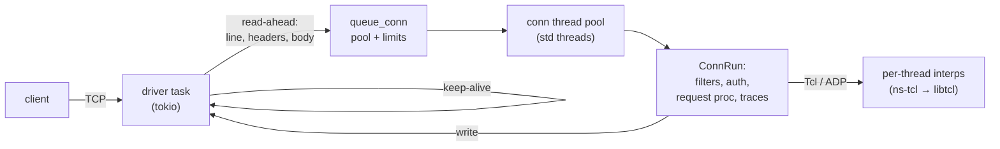

# aoloxide

**AOLserver 4.5, ported to Rust.**

aoloxide is a port of [AOLserver](https://github.com/aolserver/aolserver), the
multithreaded, Tcl-scriptable web server that ran AOL's sites, to Rust.  It
keeps AOLserver's architecture and its scripting surface: the same config
files, the same `ns_*` commands, the same ADP pages and the same Tcl library
run unchanged.  Underneath, the C core is rewritten in Rust: socket drivers,
connection thread pools, request pipeline, URL space, ADP engine, scheduler,
caches and modules.

```console
$ cargo build --release
$ ./target/release/nsd --install-home /srv/aolserver
$ ./target/release/nsd -f -t examples/nsconfig.tcl
```

## Status

Phase 1 (this release) ports the server core and the most-used modules:

| Area | State |
|---|---|
| Config (`nsconfig.tcl`, `ns_section`/`ns_param`) | ✅ |
| Socket driver (`nssock`): keep-alive, pipelining, chunked requests, `100-continue`, limits | ✅ |
| Connection thread pools, `ns_pools`, `ns_limits` | ✅ |
| Request pipeline: filters, auth hook, request procs, traces, cleanups, redirects | ✅ |
| Fastpath (static files, index files, conditional GET, caching) | ✅ |
| ADP (`<% %>`, `<%= %>`, `<script runat=server>`, registered tags, includes, streaming) | ✅ |
| Tcl interp lifecycle (`init.tcl`, `ns_ictl`, `ns_eval`, traces) | ✅ |
| ~170 `ns_*` commands (`ns_conn`, `ns_return*`, `ns_set`, `nsv_*`, `ns_cache`, `ns_job`, `ns_thread`, `ns_sched*`, `ns_http`, ...) | ✅ |
| `nslog` (access log), `nsperm` (Basic auth & permissions), `nscgi` (CGI/1.1) | ✅ |
| `nsssl` (TLS via rustls), `nszlib`, `nscp` (control port), `nsdb` (SQLite driver), `nsproxy` (worker processes) | ✅ (phase 2) |
| `nsext` (External database driver) and `nspd` (proxy daemon library, `nssqlitepd` SQLite daemon) | ✅ (phase 3) |

See [docs/porting.md](docs/porting.md) for the C-to-Rust map, every
intentional deviation, and the phase 2 plan.

## Architecture



* **`ns-core`**: engine-independent data structures and HTTP utilities
  (`Ns_Set`, URL space, globbing, request parsing, dates, URL codec, crypt,
  mimetypes, config, cache, logging, forms).
* **`ns-script`**: the scripting seam: an `Interp`/`ScriptEngine` trait
  that every `ns_*` command is written against.
* **`ns-tcl`**: the Tcl 8.6 engine (FFI to libtcl).
* **`nsd`**: the server core (`libnsd`).
* **`nslog`, `nsperm`, `nscgi`, `nsssl`, `nszlib`, `nscp`, `nsdb`, `nsproxy`, `nsext`**: modules
  (`nsproxy` also builds the `nsproxy` worker binary; install it next to `nsd`).
* **`nspd`**: the proxy-daemon side of nsext's protocol, and the
  `nssqlitepd` daemon that serves SQLite databases to an `External` pool.
* **`aoloxide`**: the `nsd` binary.

Design decisions are recorded in [docs/adr](docs/adr).

## Building

Requirements: Rust 1.85+, and Tcl 8.6 development files (`tcl8.6-dev` on
Debian/Ubuntu, `tcl-tk` on Homebrew).  Override the library location with
`TCL_LIB_DIR` / `TCL_LIB_NAME`.

```console
$ sudo apt-get install tcl8.6-dev
$ cargo test --workspace
```

Formal proofs of core invariants live in [`verus/`](verus) and are checked in
CI with [Verus](https://github.com/verus-lang/verus).

## Running

```console
$ nsd --install-home ./home          # bin/init.tcl + modules/tcl library
$ nsd -t nsconfig.tcl -f             # foreground, log to stderr
$ nsd -t nsconfig.tcl -i             # inittab mode (foreground, log file)
$ nsd -t nsconfig.tcl                # daemonize
$ nsd -c -t nsconfig.tcl             # check config and exit
```

`SIGTERM`/`SIGINT` shut down gracefully; `SIGHUP` runs `ns_atsignal`
callbacks and rolls the server log.

## License

AOLserver is distributed under the AOLserver Public License (MPL 1.1) or the
GPL.  This port is a derivative work of AOLserver, and the bundled Tcl
library files are AOLserver's own, so it is distributed under the same terms:
see [LICENSE](LICENSE).  The workspace is declared
`MPL-1.1 OR GPL-2.0-or-later`.
