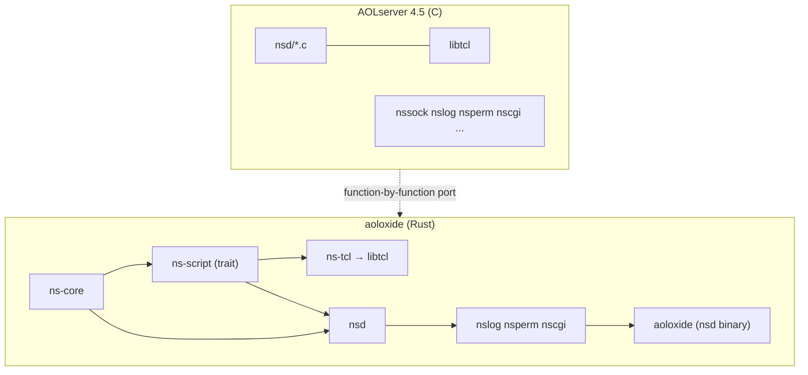

# ADR 0001: Port strategy, a faithful structural port

* Status: accepted
* Date: 2026-11-25

## Context

AOLserver 4.5 is ~85k lines of C (60k without comments) built around an
embedded Tcl interpreter.  Its value to users is behavioural: config files,
`ns_*` commands, ADP pages, module configuration, and HTTP semantics that
existing applications depend on.

## Decision

Port **structurally and faithfully**: keep AOLserver's architecture (drivers,
connection queue and thread pools, URL space, filters/traces, interp
lifecycle driven by `init.tcl`), its config keys and defaults, and its script
API, porting C logic function by function, quirks included.  Deviations are
allowed only when they fix a bug, close a security hole, or are forced by
Rust/Tcl 8.6, and each one is listed in `docs/porting.md`.

AOLserver's own Tcl library (`init.tcl`, `modules/tcl/*.tcl`, nsperm's
loader) is shipped unchanged, apart from documented Tcl 8.6 compatibility
fixes, so the port is exercised by the same scripts as the original.

Work is phased: phase 1 is the core and the most used modules (`nssock`,
`nslog`, `nsperm`, `nscgi`); phase 2 covers `nsssl`, `nszlib`, `nscp`,
`nsdb`, `nsproxy`, `nsext`/`nspd` and the remaining socket/channel commands.

## Consequences

* Existing AOLserver applications are the acceptance test.
* Some C-isms survive (string set ids, `cnsN` conn ids, Tcl list results).
* The crate layout mirrors AOLserver's directories, which makes the C
  source the primary reference for anyone extending the port.
