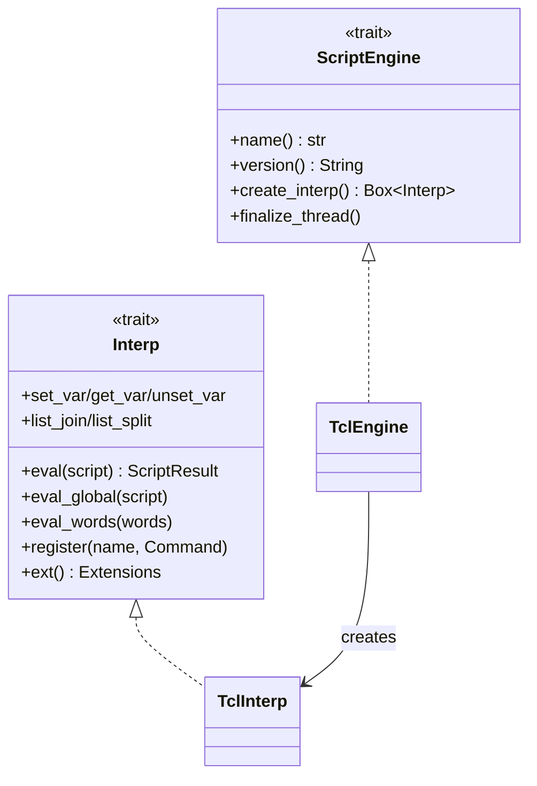

# ADR 0002: Scripting behind a trait, with libtcl as the first engine

* Status: accepted
* Date: 2026-11-25

## Context

AOLserver *is* a Tcl server: configuration, ADP and every `ns_*` command
are Tcl.  Options considered:

1. Link real Tcl 8.6 via FFI and write commands against the Tcl C API.
2. Write a pure-Rust Tcl interpreter.
3. Put an engine-agnostic trait in front, and ship libtcl as the first
   backend.

## Decision

Option 3, as chosen by the project owner.  `ns-script` defines
`ScriptEngine` (creates interps) and `Interp` (eval, variables, lists,
command registration, per-interp storage).  All ~170 `ns_*` commands in
`nsd::cmds` are written once against `&dyn Interp`.  `ns-tcl` implements it
over libtcl 8.6 with hand-written FFI (no bindgen/libclang build dependency).

Rules the trait encodes:

* Interps are thread-bound (`!Send`), matching Tcl.
* All methods take `&self`, so commands can re-enter the interp (a command
  evaluating a script that calls another command) without aliasing `&mut`.
  Engines use interior mutability.
* Values cross as UTF-8 strings; list construction and splitting are done by
  the engine so quoting always matches the engine's syntax.
* Non-OK completion codes travel in `Exception { code, message, error_info,
  error_code }`.
* Native commands have no call frame: `uplevel 1` from a command is the
  caller's caller, exactly as with C commands.

## Consequences

* Existing Tcl code runs on real Tcl 8.6 with full fidelity today.
* A pure-Rust engine can be added later without touching any command.
* Commands that need engine-specific objects (Tcl channels for
  `ns_sockopen`, `ns_returnfp`, `ns_conn copy`) go through the engine's own
  commands via `eval_words` (`read`, `puts`, `fconfigure`, `socket`).
  Features that need the C API directly have trait methods with
  engine-neutral types, whose default implementations report that the
  engine does not support them:
  * sockets: the descriptor behind a channel (`Interp::channel_fd`),
    buffered input (`channel_buffered`), wrapping a socket in a new
    channel (`socket_channel`), and channels held by a thread rather than
    an interp (`ScriptEngine::hold_socket`, `Interp::attach_held_channel`,
    `ScriptEngine::release_held`) for socket callbacks, whose channel lives
    on the callback thread across the interps that use it;
  * channel transfer between threads (`channel_detach`/`channel_attach`
    with a `Send` `DetachedChannel`, for `ns_chan`), socket channels for
    `ns_conn channel` (`channel_from_tcp`) and raw channel writes
    (`ns_adp_ctl channel`);
  * variable traces (`ns_share`) and a per-thread `Canceller`
    (`ns_ictl cancel`).
* Building requires Tcl 8.6 development files.
