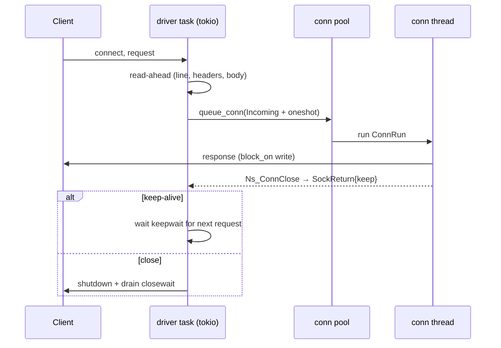

# ADR 0003: Threading model, async drivers and blocking conn threads

* Status: accepted
* Date: 2026-11-25

## Context

AOLserver uses a driver thread (accept and read-ahead) and reader threads,
which queue fully read requests onto pools of connection threads.  Each
connection thread owns cached Tcl interps, because Tcl interps are bound to
the thread that created them.  Sockets kept alive return to the driver to
wait for the next request.

## Decision

* **Drivers are tokio tasks.**  One accept loop per driver plus one task per
  client socket does read-ahead (request line and headers within
  `maxline`/`maxheader`, then the body up to the request's `maxupload`),
  keep-alive waits (`keepwait`) and graceful close (`closewait`).  A body
  whose request reaches `maxinput` is written to a temp file as it
  arrives, as AOLserver's driver thread does; the connection thread reads
  it from there.  Idle keep-alive sockets cost a task, not a
  thread.
* **Connection threads are plain OS threads** in `nsd::pool::Pool`, sized
  by `minthreads`/`maxthreads`, with idle timeout and `maxconns`
  recycling, exactly like `queue.c`.  They own per-thread, per-server interp
  caches (`nsd::interp`).
* The socket moves into the connection (`Conn::sock`) for the duration of
  the request.  Writes are blocking calls into the runtime
  (`Handle::block_on`) with `sendwait` timeouts.  `Ns_ConnClose` hands the
  stream back over a oneshot channel, and the driver task resumes keep-alive
  or closes.
* TLS plugs in as a `StreamWrapper` applied after accept, so TLS and plain
  sockets share the same read-ahead and keep-alive code.

## Consequences

* Same observable concurrency model as AOLserver: request code is
  synchronous and thread-confined, so Tcl and ADP behave identically.
* Keep-alive scales far better than one thread per idle socket.
* `NS_FILTER_PRE_QUEUE` and `NS_FILTER_READ` filters run at the start of
  connection processing rather than in the driver thread, because they need
  an interp (see `docs/porting.md`).
* Pool thread accounting is modelled and proved in `verus/pool.rs`.
